# Buro Bolides

Racen met speelgoedautootjes over je bureau. Spring over koffiekoppen, rijd loopings van een buigbare liniaal en duw elkaar van de baan. Wie van de baan rijdt is af, wie het eerst over de streep komt wint.

**Spelen:** https://endless1977.github.io/Buro_Bolides/

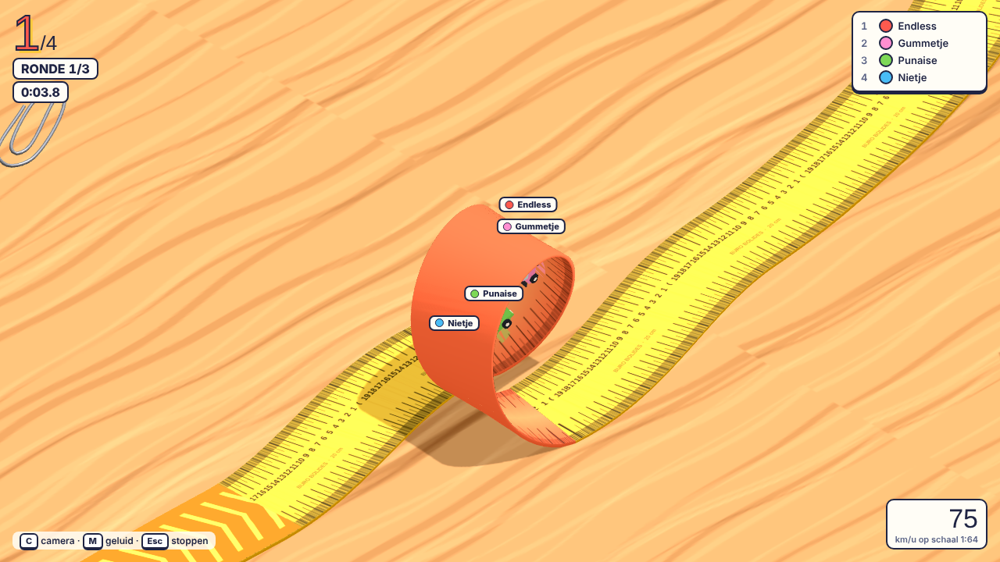

## Wat zit erin

- **8 banen**, elk met een eigen thema en flink langer dan eerst: een ronde duurt 15 tot 35 seconden
- **Schansen:** een gat in de baan met een kicker ervoor. Neem je hem te traag, dan val je erin
- **Loopings:** met genoeg vaart kom je er rond; te langzaam en je valt er bovenin uit
- **Boostpads** (oranje pijlen) vlak voor elke looping
- **Botsen en duwen:** met de handrem drift je tegen anderen aan
- **Anamorfe camera:** een vaste schuine blik als bij een diorama. De Escher-trap klopt alleen vanuit die hoek
- **Online multiplayer** voor maximaal 4 spelers, lege plekken worden bots
- **Eigen auto's:** laad een GLB-model en stel schaal, draaiing en hoogte in

## De banen

| Baan | Thema | Schansen | Loopings |
|---|---|:-:|:-:|
| Het Bureau | Liniaal, gum, rekenmachine, plakband, dambord, krant | 1 | 1 |
| Psychedelica | Achtvormige baan in steeds wisselende kleuren, met zwevende ogen en knopen | 1 | 1 |
| Smeltende Tijd | Dalí-woestijn met smeltende klokken en een staande klok met slinger | 1 | – |
| Onmogelijke Trappen | Escher-trap die eindeloos omhoog loopt | 1 | – |
| Toetsenbord | Toetsen, muismat, kabel en een muis | 2 | 1 |
| Tekentafel | Snijmat, blauwdruk, passer en loopings van een rolmaat | 1 | 2 |
| Archiefkast | Hoge baan op stapels ordners, met een nietmachine als schans | 3 | – |
| Koffiepauze | Stroopwafels, koekjes en suikerklontjes, met een sprong over een koffiekop | 2 | 1 |

## Screenshots

| | |
|---|---|
| 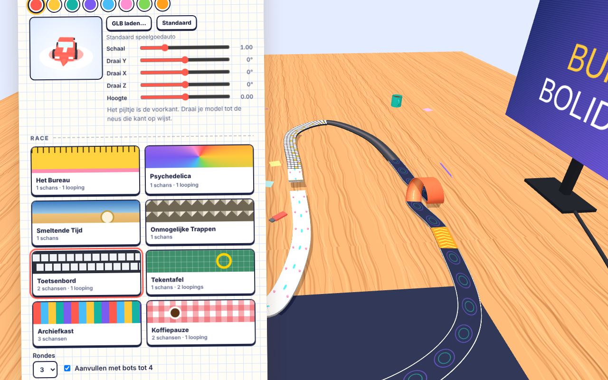 | 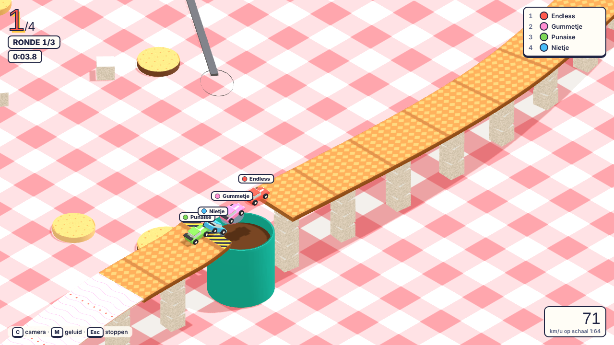 |
| Menu met garage en baankeuze | Koffiepauze: sprong over de koffiekop |
| 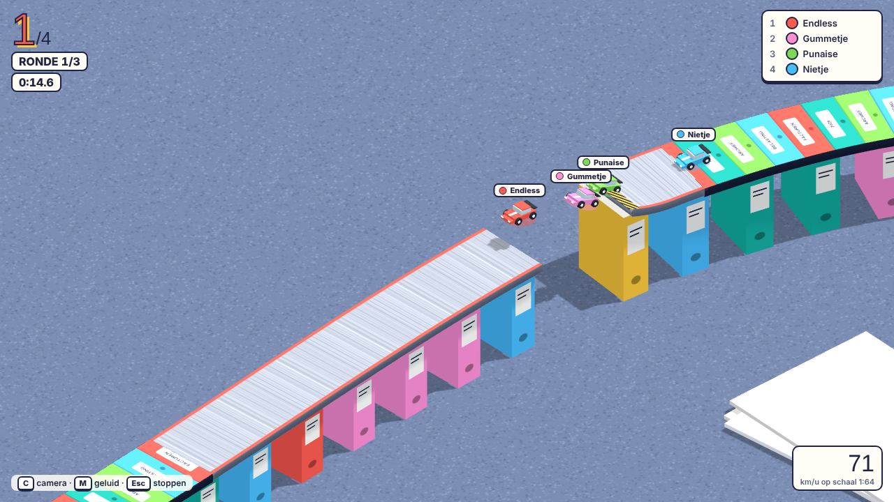 | 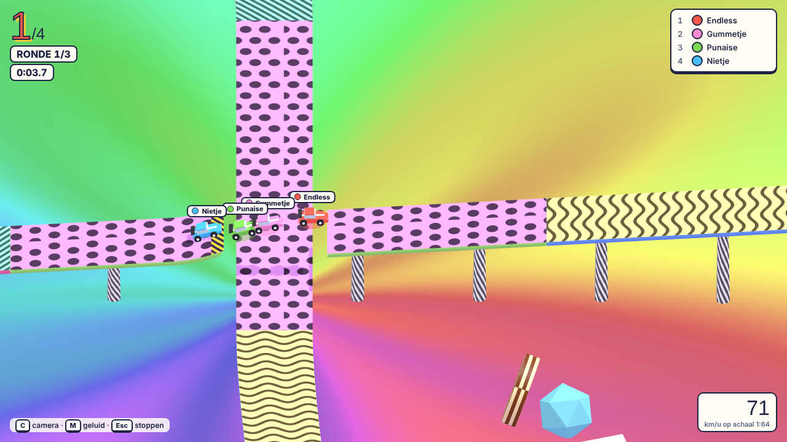 |
| Archiefkast: sprong tussen de ordners | Psychedelica: sprong over de onderdoorgang |
| 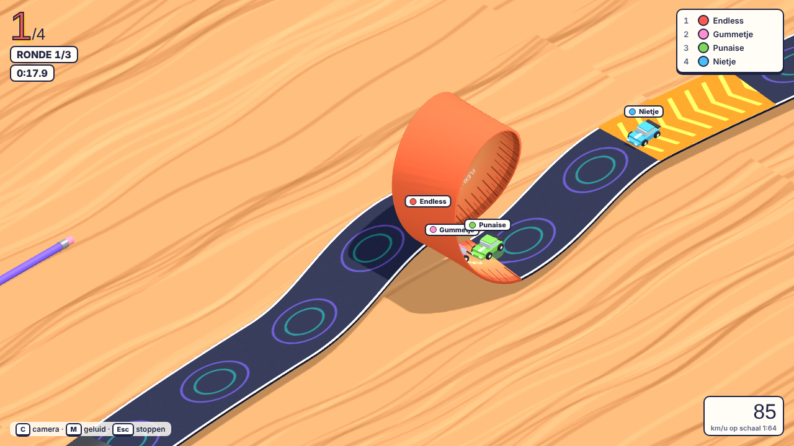 | 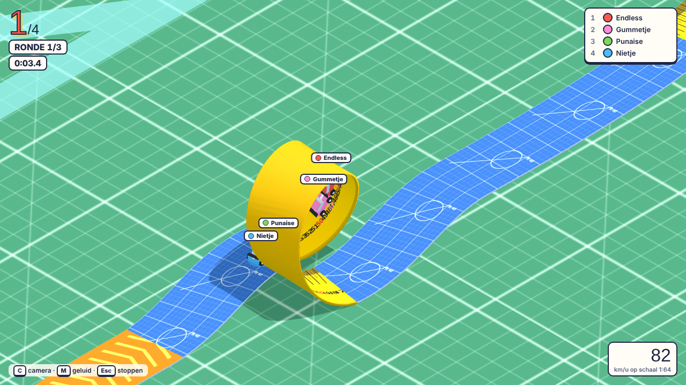 |
| Toetsenbord: looping op de muismat | Tekentafel: looping van een rolmaat |
| 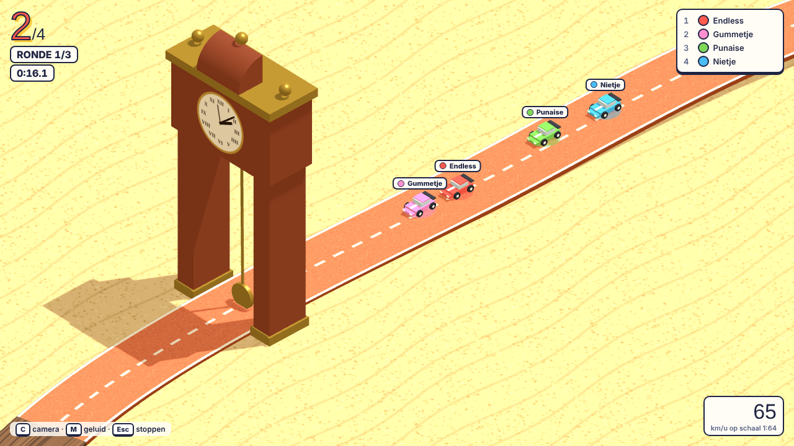 | 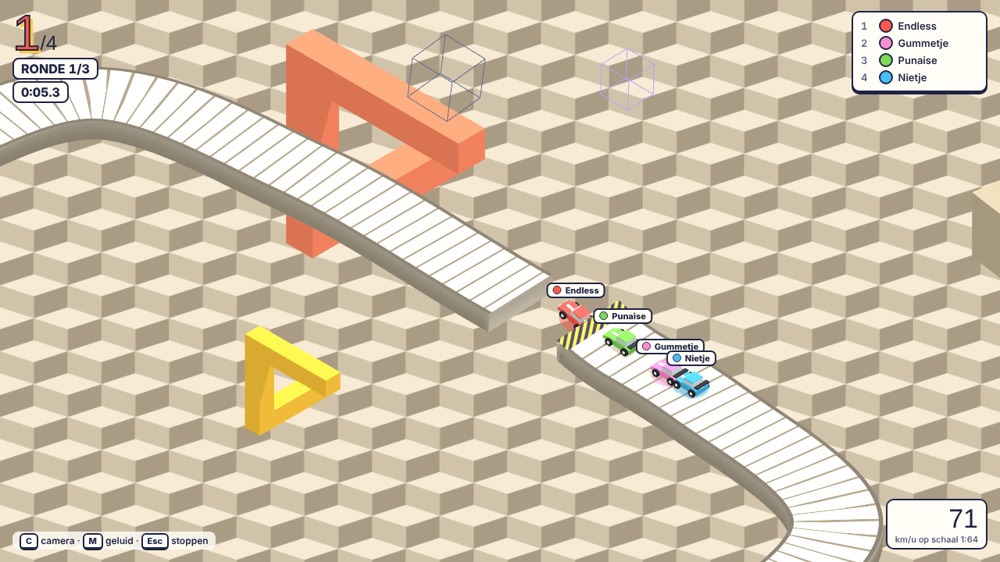 |
| Smeltende Tijd: de slinger slaat je opzij | Onmogelijke Trappen: schans op de trap |
| 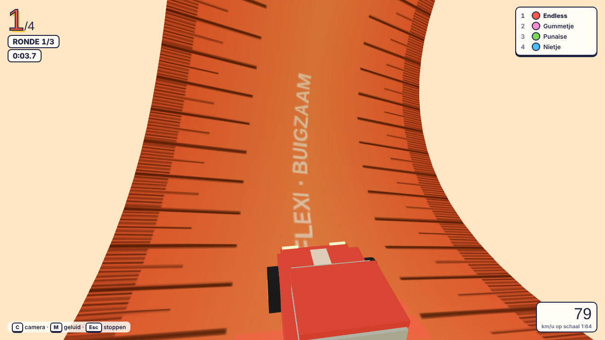 | 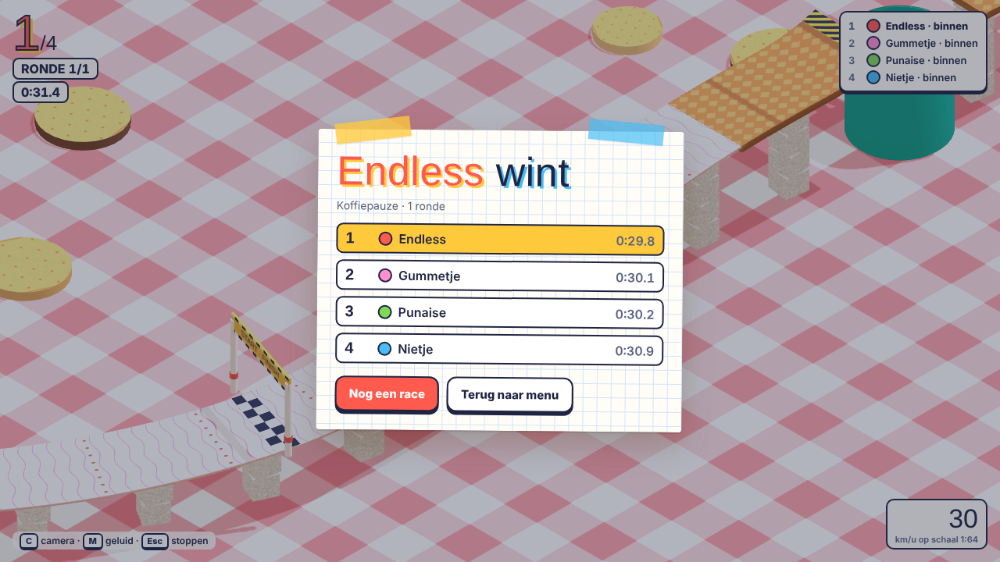 |
| Camera achter de auto, midden in een looping | Uitslag na de race |

## Besturing

| Toets | Actie |
|---|---|
| ↑ / W | Gas |
| ↓ / S | Remmen, achteruit |
| ← → / A D | Sturen |
| Spatie | Handrem: driften en duwen |
| C | Wisselen tussen de anamorfe blik en de camera achter de auto |
| M | Geluid aan of uit |
| Scroll | Inzoomen |
| Esc | Race verlaten |

Een gamepad werkt ook. Op een telefoon of tablet verschijnen knoppen op het scherm.

## Samen online spelen

1. De host klikt op **Online kamer openen** en krijgt een code van 4 tekens.
2. De andere spelers openen dezelfde pagina, vullen de code in en klikken op **Meedoen**.
3. De host kiest de baan en het aantal rondes en start de race.

De verbinding loopt peer-to-peer via PeerJS. Er is geen eigen server nodig.

## Eigen auto (GLB)

In de garage laad je met **GLB laden…** een eigen model. Het wordt automatisch op speelgoedautoformaat gebracht. Met de schuifjes stel je schaal, draaiing (X, Y, Z) en hoogte in; het rode pijltje is de voorkant. Online krijgen de andere spelers jouw model ook te zien. Draco-gecomprimeerde modellen worden niet ondersteund, en houd het bestand onder de 12 MB.

## Techniek

Het hele spel is één HTML-bestand (`index.html`) met three.js r128 en PeerJS van een CDN. Alle texturen worden in de browser getekend, er zijn geen afbeeldingen nodig. Chrome of Edge wordt aanbevolen.
