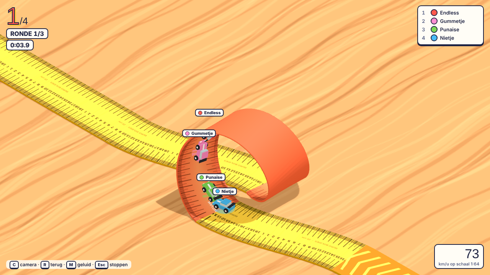
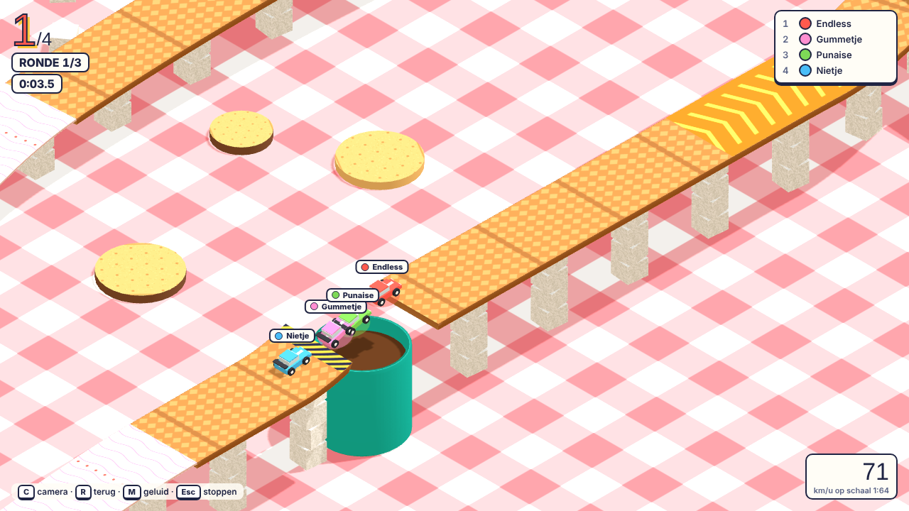
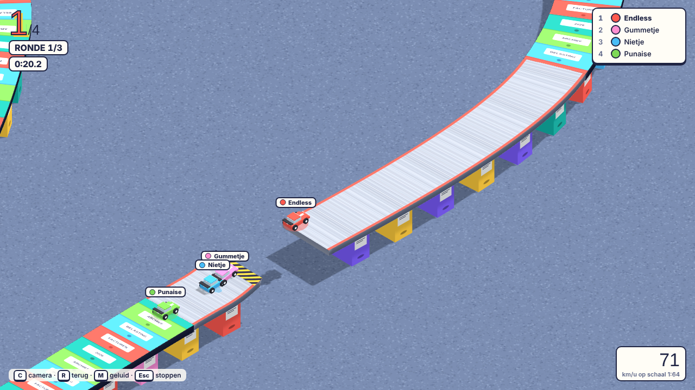
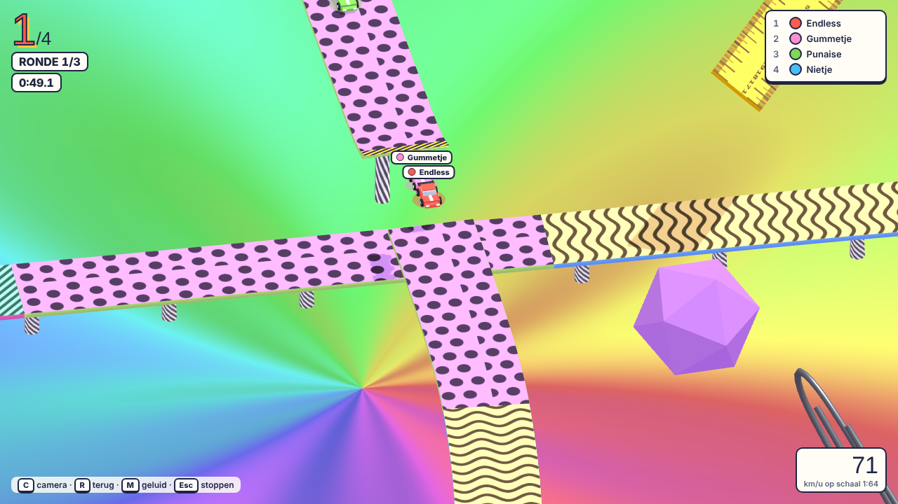
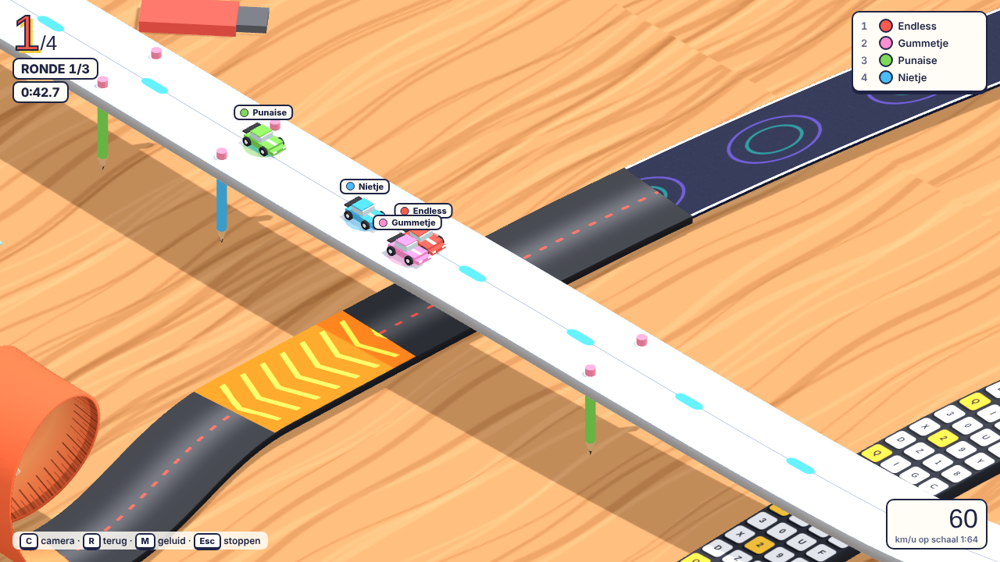
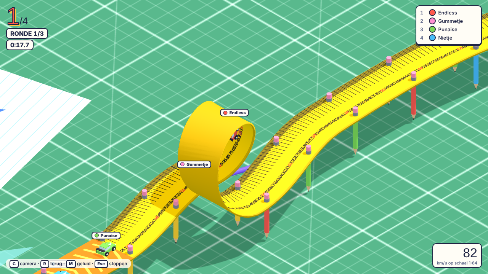
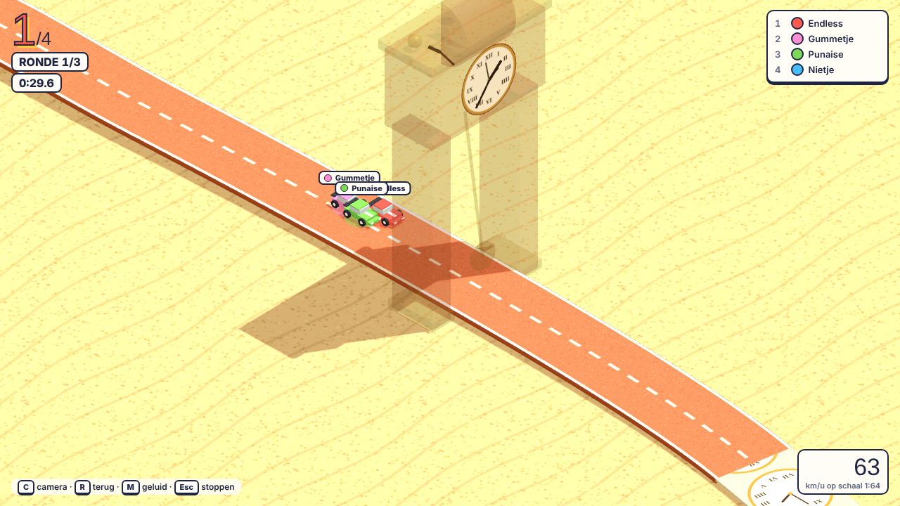

# Buro Bolides

Racen met speelgoedautootjes over je bureau, op banen die gebaseerd zijn op beroemde Grand Prix-circuits. Spring over koffiekoppen, rijd loopings van een buigbare liniaal en duw elkaar van de baan. Wie het eerst over de streep komt wint.

**Spelen:** https://endless1977.github.io/Buro_Bolides/

## Wat zit erin

- **8 banen** naar echte circuits, elk met een eigen thema en een eigen twist. Een ronde duurt ongeveer 50 seconden
- **Schansen:** een gat in de baan met een kicker ervoor. Neem je hem te traag, dan val je erin
- **Loopings:** met genoeg vaart kom je er rond; te langzaam en je valt er bovenin uit
- **Kruisingen:** op Suzuka en Silverstone gaat de baan via een brug over zichzelf heen
- **Hoogteverschillen:** klimmen naar de Raidillon, afdalen langs de Scheivlak
- **Boostpads** (oranje pijlen) vlak voor elke looping
- **Naast de baan is niet af:** je rijdt langzaam verder over het bureau, de vloer of het tafelkleed en kunt terug de baan op rijden. Staat de baan te hoog, dan brengt **R** je terug; na een paar seconden gebeurt dat vanzelf. Afsnijden telt niet: dan ga je terug naar waar je de baan verliet
- **Afgronden:** alleen waar echt niets is (de rand van het bureau, de Escher-trap) val je naar beneden en kom je achter de plek waar het misging terug op de baan. Die achterstand is je straf
- **Botsen en duwen:** met de handrem drift je tegen anderen aan
- **Anamorfe camera:** een vaste schuine blik als bij een diorama. De Escher-trap klopt alleen vanuit die hoek
- **Online multiplayer** voor maximaal 4 spelers, lege plekken worden bots
- **Eigen auto's:** laad een GLB-model en stel schaal, draaiing en hoogte in

## De banen

| Baan | Circuit | Twist | Schansen | Loopings |
|---|---|---|:-:|:-:|
| Het Bureau | Monza | Looping op het rechte stuk, schans op de Serraglio, verhoogde Parabolica | 1 | 1 |
| Psychedelica | Suzuka | De achtvorm met een sprong precies boven de kruising | 1 | 1 |
| Smeltende Tijd | Monaco | De staande klok is de tunnel; schans bij het zwembad over een smeltende klok | 1 | – |
| Onmogelijke Trappen | Penrose-trap | Eindeloos omhoog, alleen kloppend in de anamorfe blik | 1 | – |
| Toetsenbord | Silverstone | De Hangar Straight is een brug over Wellington én start/finish | 1 | 1 |
| Tekentafel | Spa-Francorchamps | Sprong over de top van de Raidillon, loopings op Kemmel en Blanchimont | 1 | 2 |
| Archiefkast | Interlagos | Hoog op ordnertorens, met een nietmachine als schans | 3 | – |
| Koffiepauze | Zandvoort | Sprong over een koffiekop, looping van een lepel, Hunserug als achtbaan | 2 | 1 |

## Screenshots

| | |
|---|---|
|  |  |
| Menu met garage en baankeuze | Zandvoort: sprong over de koffiekop |
|  |  |
| Interlagos: sprong tussen de ordners | Suzuka: sprong boven de kruising |
|  |  |
| Silverstone: de Hangar Straight als brug | Spa: looping van een rolmaat op Kemmel |
|  |  |
| Monaco: de staande klok is de tunnel | Onmogelijke Trappen: schans op de trap |
|  |  |
| Camera achter de auto, midden in een looping | Uitslag na de race |

## Besturing

| Toets | Actie |
|---|---|
| ↑ / W | Gas |
| ↓ / S | Remmen, achteruit |
| ← → / A D | Sturen |
| Spatie | Handrem: driften en duwen |
| C | Wisselen tussen de anamorfe blik en de camera achter de auto |
| R | Naast de baan: terug op de baan |
| M | Geluid aan of uit |
| Scroll | Inzoomen |
| Esc | Race verlaten |

Een gamepad werkt ook. Op een telefoon of tablet verschijnen knoppen op het scherm.

## Samen online spelen

1. De host klikt op **Online kamer openen** en krijgt een code van 4 tekens.
2. De andere spelers openen dezelfde pagina, vullen de code in en klikken op **Meedoen**.
3. De host kiest de baan en het aantal rondes en start de race.

De verbinding loopt peer-to-peer via PeerJS. Er is geen eigen server nodig.

## Eigen auto (GLB)

In de garage laad je met **GLB laden…** een eigen model. Het wordt automatisch op speelgoedautoformaat gebracht. Met de schuifjes stel je schaal, draaiing (X, Y, Z) en hoogte in; het rode pijltje is de voorkant. Online krijgen de andere spelers jouw model ook te zien. Draco-gecomprimeerde modellen worden niet ondersteund, en houd het bestand onder de 12 MB.

## Techniek

Het hele spel is één HTML-bestand (`index.html`) met three.js r128 en PeerJS van een CDN. Alle texturen worden in de browser getekend, er zijn geen afbeeldingen nodig. Chrome of Edge wordt aanbevolen.
